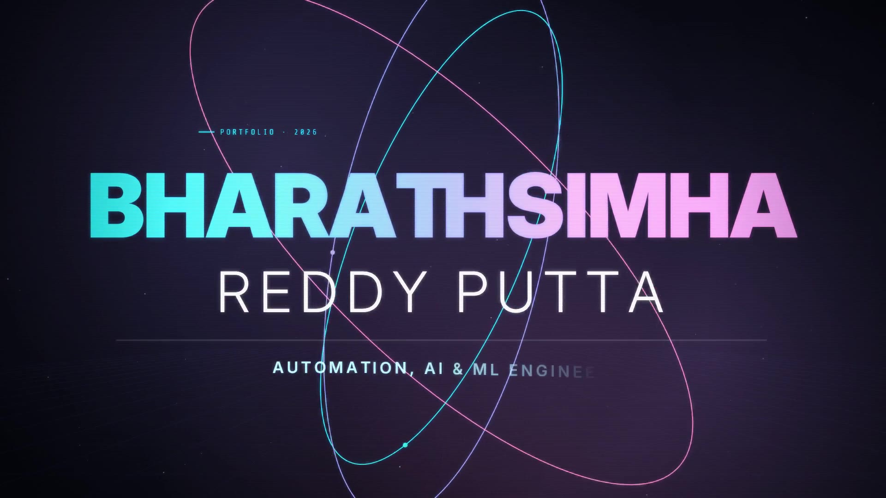

# Bharathsimha Reddy Putta - AI/ML Engineer Portfolio

🚀 **Modern, Interactive Portfolio Website showcasing AI/ML expertise and innovative projects**

## 🎬 Showreel — Portfolio Motion Film

A ~5-minute motion-graphics film covering about me, experience (Jane, Aiqwip, freelance, internships), eight enterprise AI platforms and featured GitHub projects, using real images from the repositories. It is generated entirely from code — canvas animation, Playwright frame capture, ffmpeg and a Python-synthesised score. See [`motion-film/`](motion-film/) to edit and rebuild it.

## 🌟 Features

- **Modern Design**: Clean, professional layout with stunning animations
- **Responsive**: Fully responsive design that works on all devices
- **Interactive**: Smooth scrolling, hover effects, and dynamic animations
- **AI-Themed**: Neural network animations and AI-focused visual elements
- **Performance Optimized**: Fast loading with optimized assets
- **SEO Ready**: Structured markup for better search engine visibility

## 🛠️ Technologies Used

- **HTML5**: Semantic markup and modern structure
- **CSS3**: Advanced styling with CSS Grid, Flexbox, and animations
- **JavaScript**: Interactive features and smooth user experience
- **Font Awesome**: Professional icons
- **Google Fonts**: Inter font family for modern typography

## 🎨 Design Highlights

### Hero Section
- Animated typing effect for name introduction
- Interactive neural network visualization
- Professional statistics display
- Call-to-action buttons with hover effects

### Projects Showcase
- Featured project highlighting
- Technology tags for each project
- Hover animations and transitions
- Direct links to GitHub and live demos

### Experience Timeline
- Interactive timeline design
- Professional experience with achievements
- Educational background
- Responsive layout for mobile devices

### Contact Section
- Multiple contact methods
- Social media integration
- Interactive contact cards
- Professional presentation

## 🚀 Quick Start

1. **Clone or Download** the repository
2. **Open** `index.html` in your web browser
3. **Customize** the content with your information
4. **Deploy** to your preferred hosting platform

## 📱 Responsive Design

The portfolio is fully responsive and optimized for:
- Desktop computers (1200px+)
- Tablets (768px - 1199px)
- Mobile phones (320px - 767px)

## 🎯 Customization Guide

### Personal Information
Update the following sections in `index.html`:
- Hero section: Name, title, and description
- About section: Mission and skills
- Projects: Add your own projects with descriptions
- Experience: Update with your professional history
- Contact: Your email, phone, and social links

### Styling
Modify `styles.css` to:
- Change color scheme (CSS variables in `:root`)
- Adjust animations and transitions
- Customize layout and spacing
- Add new components

### Functionality
Enhance `script.js` to:
- Add new interactive features
- Modify animations
- Integrate with external APIs
- Add form handling

## 🌐 Deployment Options

### GitHub Pages
1. Push to GitHub repository
2. Enable GitHub Pages in repository settings
3. Select source branch (main/master)

### Netlify
1. Connect your GitHub repository
2. Deploy automatically on push
3. Custom domain support available

### Vercel
1. Import from GitHub
2. Zero-config deployment
3. Automatic HTTPS and CDN

### Traditional Hosting
1. Upload files via FTP
2. Ensure `index.html` is in root directory
3. Configure domain settings

## 📊 Performance Features

- **Optimized Images**: Compressed and properly sized
- **Minified Code**: Clean, efficient code structure
- **Lazy Loading**: Intersection Observer for animations
- **Smooth Scrolling**: Hardware-accelerated animations
- **Mobile-First**: Responsive design approach

## 🔧 Browser Support

- Chrome (recommended)
- Firefox
- Safari
- Edge
- Mobile browsers (iOS Safari, Chrome Mobile)

## 📈 SEO Optimization

- Semantic HTML structure
- Meta tags for social sharing
- Proper heading hierarchy
- Alt text for images
- Fast loading times

## 🎨 Color Scheme

The portfolio uses a modern, professional color palette:
- **Primary**: #6366f1 (Indigo)
- **Secondary**: #06b6d4 (Cyan)
- **Accent**: #f59e0b (Amber)
- **Text**: #1f2937 (Dark Gray)
- **Background**: #ffffff (White) / #f9fafb (Light Gray)

## 📞 Contact & Support

**Bharathsimha Reddy Putta**
- 📧 Email: bharathreddyget@gmail.com
- 📱 Phone: +91 9347294579
- 💼 LinkedIn: [bharathsimha-reddy-putta](https://www.linkedin.com/in/bharathsimha-reddy-putta-a2292a211/)
- 🐙 GitHub: [bharathmrr](https://github.com/bharathmrr)

## 📄 License

This project is open source and available under the [MIT License](LICENSE).

---

**Built with ❤️ and AI precision by Bharathsimha Reddy Putta**

*Transforming ideas into intelligent solutions with cutting-edge AI technology*